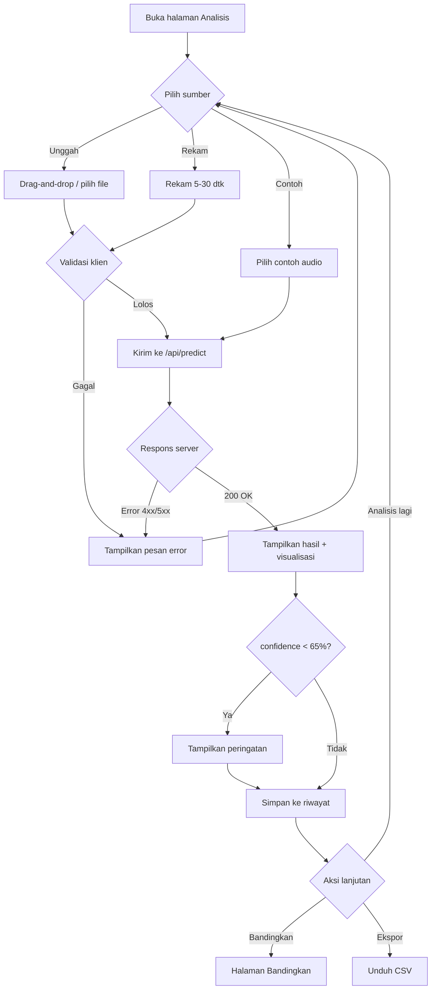

# PRD — Sound Lab: Klasifikasi Suara Berisik vs Non-Berisik

**Ringkasan.** Sound Lab adalah website yang mengimplementasikan model Random Forest hasil Proyek Sains Data untuk mengklasifikasikan rekaman suara lingkungan menjadi **berisik** atau **non-berisik**. Pengguna mengunggah atau merekam audio, lalu menerima label, confidence, visualisasi (waveform, spektrogram, MFCC), dan penjelasan berbahasa awam. Dokumen ini menjadi sumber kebutuhan produk untuk dokumen lain (desain.md, arsitektur.md, model-spec.md, api-spec.md, testing.md, tasks.md, prompt.md).

## Daftar Isi
1. Latar Belakang
2. Masalah
3. Tujuan dan Non-Tujuan
4. Target Pengguna dan Persona
5. User Stories (MoSCoW)
6. Daftar Fitur dan Acceptance Criteria
7. Alur Pengguna
8. Metrik Keberhasilan
9. Kebutuhan Non-Fungsional
10. Risiko
11. Asumsi
12. Out-of-Scope

---

## 1. Latar Belakang
Mata kuliah Proyek Sains Data menghasilkan model klasifikasi audio (`model_klasifikasi_audio.pkl`) yang selama ini hanya bisa dijalankan lewat notebook `audio.ipynb`. Hasilnya sulit didemonstrasikan kepada dosen penguji dan teman sekelas tanpa menjalankan kode. Website membuat model bisa dicoba langsung dan hasilnya dapat dijelaskan secara visual.

Ringkasan model (sumber kebenaran, konsisten di semua dokumen):

| Aspek | Nilai |
|---|---|
| Algoritma | Random Forest (`n_estimators=100`, `max_depth=10`, `random_state=42`) |
| Library | scikit-learn 1.8.0 (wajib dipin) |
| Kelas | `berisik`, `non-berisik` (urutan dari `model.classes_`) |
| Jumlah fitur | 10 dari 19 kandidat (k=10, 5-fold CV) |
| Akurasi test | 85% (presisi 0,85; recall 0,85; F1 0,85; ROC-AUC 0,8688) |
| CV 5-fold | 84,15% (± 2,94%) |
| Data | ± 200 file (latih 158, uji 40), ± 30 detik per file |
| Parameter audio | `target_sr=22050`, `top_db=25`, `chunk_duration=3` |

## 2. Masalah
1. Model tidak bisa dicoba oleh orang yang tidak menjalankan notebook.
2. Keluaran model berupa angka mentah sehingga sulit dipahami nonteknis.
3. Tidak ada cara membandingkan dua rekaman atau melacak hasil percobaan.
4. Keterbatasan model (dataset kecil, satu domain perekaman) belum dikomunikasikan kepada pengguna.

## 3. Tujuan dan Non-Tujuan
**Tujuan**
- T1. Pengguna mendapat hasil klasifikasi dalam < 10 detik untuk audio 30 detik.
- T2. Hasil dapat dijelaskan: pengguna paham mengapa audio dinilai berisik/non-berisik.
- T3. Pipeline fitur web app identik dengan training (split + concatenate).
- T4. Keterbatasan model tampil jelas di UI (peringatan confidence rendah, halaman Batasan & Etika).
- T5. Demo siap dipresentasikan dan dapat di-deploy gratis.

**Non-Tujuan**
- Tidak melatih ulang model di web.
- Tidak menyimpan audio secara permanen.
- Tidak mengukur tingkat kebisingan dalam dB SPL (model hanya klasifikasi biner).
- Tidak ada akun pengguna atau autentikasi.

## 4. Target Pengguna dan Persona
**Target:** dosen/penguji, teman sekelas, pengelola fasilitas (perpustakaan, ruang kerja bersama).

| Persona | Profil | Kebutuhan | Kekhawatiran |
|---|---|---|---|
| **Bu Ratna, dosen penguji** | 45 th, dosen sains data, menilai kelayakan proyek | Melihat model berjalan nyata, metrik, dan keterbatasannya | Hasil tampak "ajaib" tanpa penjelasan ilmiah |
| **Dimas, teman sekelas** | 20 th, mahasiswa Teknik Informatika, mencoba dari HP | Mencoba rekaman suara sendiri, membandingkan dua tempat | Antarmuka sulit dipakai di layar kecil |
| **Pak Hendra, pengelola perpustakaan** | 38 th, nonteknis, ingin cek ruang baca | Jawaban jelas "berisik atau tidak" dan alasannya dalam bahasa awam | Privasi rekaman dan hasil yang tidak bisa dipercaya |

## 5. User Stories

| ID | Cerita | Prioritas |
|---|---|---|
| US01 | Sebagai pengguna, saya ingin mengunggah file audio dengan drag-and-drop, agar bisa menguji rekaman yang sudah ada. | Must |
| US02 | Sebagai pengguna, saya ingin melihat label, confidence, dan probabilitas dua kelas, agar tahu hasil klasifikasi dan keyakinannya. | Must |
| US03 | Sebagai pengguna, saya ingin merekam suara dari mikrofon dengan level meter live, agar bisa menguji suara sekitar saya. | Must |
| US04 | Sebagai dosen, saya ingin halaman Tentang Model berisi metrik dan perbandingan 6 model, agar bisa menilai kelayakan ilmiahnya. | Must |
| US05 | Sebagai pengguna, saya ingin penjelasan "mengapa hasilnya begini" dalam bahasa awam, agar paham tanpa latar teknis. | Must |
| US06 | Sebagai pengguna, saya ingin peringatan bila confidence < 65%, agar tidak terlalu percaya pada hasil yang meragukan. | Must |
| US07 | Sebagai dosen, saya ingin halaman Batasan & Etika, agar tahu cakupan dan keterbatasan model. | Must |
| US08 | Sebagai pengguna, saya ingin waveform dan spektrogram, agar bisa melihat bentuk sinyal audio. | Should |
| US09 | Sebagai pengguna, saya ingin pemutar audio sinkron dengan kursor waveform, agar bisa mengaitkan suara dengan grafik. | Should |
| US10 | Sebagai pengguna, saya ingin timeline prediksi per chunk, agar tahu bagian rekaman mana yang berisik. | Should |
| US11 | Sebagai pengguna, saya ingin membandingkan 10 fitur dengan rata-rata kelas, agar paham posisi audio saya. | Should |
| US12 | Sebagai pengguna, saya ingin contoh audio siap pakai, agar bisa mencoba tanpa menyiapkan file. | Should |
| US13 | Sebagai pengguna, saya ingin riwayat sesi dan ekspor CSV, agar bisa menyalin hasil ke laporan. | Should |
| US14 | Sebagai pengguna, saya ingin membandingkan dua audio berdampingan, agar bisa membandingkan dua lokasi. | Could |
| US15 | Sebagai pengguna HP, saya ingin tampilan responsif, agar nyaman dipakai di layar 360 px. | Must |
| US16 | Sebagai pengguna, saya ingin tahu audio saya tidak disimpan, agar merasa aman. | Must |
| US17 | Sebagai pengguna, saya ingin mengubah tema terang/gelap. | Won't (versi ini) |

## 6. Daftar Fitur dan Acceptance Criteria

| ID | Fitur | Prioritas |
|---|---|---|
| F01 | Upload drag-and-drop | Must |
| F02 | Rekam mikrofon | Must |
| F03 | Contoh audio | Should |
| F04 | Pemutar audio sinkron waveform | Should |
| F05 | Kartu hasil | Must |
| F06 | Waveform | Should |
| F07 | Spektrogram | Should |
| F08 | Timeline prediksi per chunk | Should |
| F09 | Perbandingan 10 fitur vs rata-rata kelas | Should |
| F10 | Penjelasan "mengapa hasilnya begini" | Must |
| F11 | Peringatan confidence < 65% | Must |
| F12 | Riwayat sesi + ekspor CSV | Should |
| F13 | Perbandingan 2 audio | Could |
| F14 | Halaman Tentang Model | Must |
| F15 | Halaman Batasan & Etika | Must |

### F01 — Upload drag-and-drop
- Menerima `.mp3 .wav .ogg .flac .m4a`; ekstensi lain ditolak dengan pesan "Format tidak didukung" tanpa mengirim ke server.
- File > 15 MB ditolak di klien sebelum upload, dengan pesan menyebut ukuran file dan batas 15 MB.
- Zona upload berubah ke state "aktif" (border aksen) ≤ 100 ms saat file diseret ke atasnya.
- Tombol "Pilih file" dapat dijangkau dan dipicu keyboard (Enter/Spasi).
- Hanya 1 file per analisis; menjatuhkan lebih dari 1 file memakai file pertama dan menampilkan toast info.

### F02 — Rekam mikrofon
- Durasi rekam 5–30 detik. Tombol "Selesai" nonaktif sebelum 5 detik; rekaman berhenti otomatis di 30 detik.
- Level meter live memperbarui ≥ 20 kali per detik dan bereaksi terhadap suara.
- Jika izin mikrofon ditolak, tampil pesan panduan mengaktifkan izin dan tombol upload tetap bisa dipakai.
- Setelah rekaman berhenti, pengguna dapat memutar ulang sebelum menekan "Analisis" atau mengulang rekaman.
- Hasil rekaman dikirim ke `/api/predict` sebagai file (WAV atau WebM yang dikonversi server).

### F03 — Contoh audio
- Tersedia minimal 3 contoh: 1 berisik, 1 non-berisik, 1 ambigu.
- Satu klik pada contoh langsung menjalankan analisis tanpa dialog tambahan.
- Setiap contoh menampilkan label sumber ("Contoh bawaan") di riwayat.

### F04 — Pemutar audio sinkron waveform
- Kontrol: putar/jeda, seek lewat klik waveform, tampil waktu `mm:ss / mm:ss`.
- Kursor garis vertikal bergerak sinkron dengan audio, selisih posisi ≤ 100 ms.
- Pintasan keyboard: Spasi = putar/jeda, ←/→ = mundur/maju 5 detik saat pemutar fokus.

### F05 — Kartu hasil
- Menampilkan badge label (pill, ikon speaker atau speaker-mute), confidence dalam persen (1 desimal), dan probabilitas kedua kelas yang berjumlah 100% ± 0,1.
- Warna kelas konsisten: berisik `#FF6B35`, non-berisik `#22D3C5`.
- Confidence yang ditampilkan = probabilitas kelas terpilih (`max(predict_proba)`).
- Menampilkan nama file, durasi, dan waktu proses.

### F06 — Waveform
- Waveform ter-downsample ke ≤ 2000 titik, dirender ≤ 500 ms setelah respons diterima.
- Sumbu waktu dalam detik; penanda batas chunk 3 detik dapat diaktifkan.

### F07 — Spektrogram
- Colormap "inferno" (sama dengan notebook), sumbu waktu (detik) dan frekuensi (Hz), disertai legenda warna.
- Tersedia teks alternatif ringkas untuk pembaca layar.

### F08 — Timeline prediksi per chunk
- Satu sel per chunk 3 detik, diwarnai sesuai kelas dan opasitas sesuai confidence.
- Berlabel "Indikatif" disertai tooltip: model dilatih pada agregat file ± 30 detik, bukan per chunk.
- Hover/tap pada sel menampilkan rentang waktu, label, dan confidence chunk.

### F09 — Perbandingan 10 fitur vs rata-rata kelas
- Tabel/bar horizontal 10 fitur sesuai urutan: `rms_mean, mfcc1_mean, rms_std, mfcc3_mean, zcr_mean, mfcc6_mean, mfcc7_mean, mfcc13_mean, mfcc5_mean, centroid_mean`.
- Tiap baris menampilkan nilai audio, rata-rata kelas berisik, rata-rata kelas non-berisik, dan penanda kelas yang lebih dekat.
- Nilai tampil dalam JetBrains Mono dengan presisi yang konsisten (lihat api-spec.md).

### F10 — Penjelasan "mengapa hasilnya begini"
- Menampilkan 3 alasan teratas dalam kalimat awam (tanpa istilah seperti "MFCC") berdasarkan kontribusi fitur (metode di model-spec.md).
- Setiap alasan memuat arah (lebih keras/lebih pelan dari rata-rata kelas) dan satu kalimat pendek.
- Ada tautan "Lihat detail teknis" ke panel F09.

### F11 — Peringatan confidence < 65%
- Banner peringatan kuning/ungu tampil bila confidence < 65%, memuat saran (rekam ulang di lokasi lebih konsisten, durasi ≥ 15 detik).
- Banner memakai `role="status"` dan tidak menyembunyikan hasil.
- Ambang 65% dapat dikonfigurasi lewat `.env` (`CONFIDENCE_WARN_THRESHOLD=0.65`).

### F12 — Riwayat sesi + ekspor CSV
- Setiap analisis tersimpan di memori browser (sessionStorage), hilang saat tab ditutup. Audio tidak disimpan.
- Riwayat menampilkan waktu, nama file/sumber, label, confidence; maksimal 50 entri (terlama dihapus).
- Ekspor CSV berisi kolom: `waktu, nama_file, sumber, label, confidence, prob_berisik, prob_non_berisik, durasi_detik` + 10 fitur sesuai urutan. Encoding UTF-8, pemisah koma, titik sebagai desimal.
- Tombol "Hapus riwayat" meminta konfirmasi lewat modal.

### F13 — Perbandingan 2 audio
- Pengguna memilih 2 entri dari riwayat atau mengunggah 2 file; keduanya dianalisis berurutan.
- Tampilan berdampingan: kartu hasil, waveform, selisih nilai 10 fitur.
- Jika salah satu analisis gagal, bagian yang berhasil tetap tampil dan bagian gagal menampilkan pesan error.

### F14 — Halaman Tentang Model
- Memuat: algoritma dan hyperparameter, 10 fitur dan artinya, metrik (akurasi 85%, presisi/recall/F1 0,85, ROC-AUC 0,8688, CV 84,15% ± 2,94%), confusion matrix (17 benar dan 3 salah per kelas), perbandingan 6 model, grafik importance.
- Data diambil dari `/api/model-info` sehingga konsisten dengan model yang dimuat.

### F15 — Halaman Batasan & Etika
- Memuat minimal: dataset kecil (198 file), satu domain perekaman, suara di luar distribusi (musik, hujan, mesin berat), hasil bukan pengukuran dB, kebijakan privasi (audio dihapus setelah diproses), penggunaan yang tidak disarankan.
- Dapat diakses dari footer setiap halaman dan dari banner F11.

## 7. Alur Pengguna

**Langkah:**
1. Pengguna membuka halaman Analisis.
2. Memilih sumber: unggah file, rekam mikrofon, atau contoh audio.
3. Klien memvalidasi format dan ukuran.
4. Klien mengirim ke `POST /api/predict`; UI menampilkan loading dengan tahapan.
5. Server memvalidasi, mengekstrak fitur, memprediksi, lalu menghapus file temporer.
6. UI menampilkan kartu hasil, peringatan (jika confidence < 65%), visualisasi, dan penjelasan.
7. Hasil masuk ke riwayat sesi.
8. Pengguna dapat membandingkan, mengekspor CSV, atau menganalisis audio lain.

## 8. Metrik Keberhasilan

| Metrik | Target | Cara ukur |
|---|---|---|
| Waktu proses audio 30 dtk | < 10 dtk (p95) pada server target | Tes performa (testing.md) |
| Paritas fitur vs notebook (split) | Selisih relatif ≤ 1% per fitur | Tes unit |
| Akurasi sampel contoh bawaan | 3 dari 3 sesuai label contoh | Tes integrasi |
| Keberhasilan alur utama | ≥ 90% uji coba 5 pengguna selesai tanpa bantuan | Uji kegunaan manual |
| Skor Lighthouse Accessibility | ≥ 90 | Lighthouse |
| Ketersediaan demo saat presentasi | Cold start ≤ 60 dtk dan dipanaskan sebelum sesi | Checklist deploy |

## 9. Kebutuhan Non-Fungsional

| Kategori | Kebutuhan |
|---|---|
| Performa | < 10 dtk untuk audio 30 dtk; model dimuat sekali saat startup |
| Batas file | Maks 15 MB; durasi maks 120 dtk |
| Durasi minimum | File < 0,5 dtk ditolak (422); 0,5–3 dtk di-zero-pad ke 1 chunk |
| Format | `.mp3 .wav .ogg .flac .m4a` |
| Privasi | File temporer dihapus segera setelah diproses (blok `finally`); tanpa penyimpanan permanen; log tidak memuat isi audio |
| Keamanan | Rate limit per IP; validasi tipe berdasarkan isi file; CORS terbatas ke origin frontend |
| Aksesibilitas | WCAG 2.1 AA, navigasi keyboard penuh |
| Responsif | Breakpoint 360/768/1280 |
| Bahasa | Seluruh UI dan pesan error dalam Bahasa Indonesia |
| Kompatibilitas browser | Chrome, Edge, Firefox, dan Safari versi 2 tahun terakhir |
| Reproduktibilitas | Semua versi library dipin di `requirements.txt` |

## 10. Risiko

| ID | Risiko | Dampak | Mitigasi |
|---|---|---|---|
| R1 | Training memakai split + concatenate, sedangkan inferensi lama memakai trim | Fitur beda, prediksi menyimpang | Web app memakai split + concatenate; verifikasi paritas dengan `fitur_audio.csv` |
| R2 | Dataset kecil (198 file), satu domain | Generalisasi buruk | Halaman Batasan, peringatan confidence |
| R3 | Audio di luar distribusi (musik, hujan, mesin) | Prediksi percaya diri tetapi salah | Peringatan di UI; dokumentasi keterbatasan |
| R4 | Cold start dan batas RAM hosting gratis | Demo lambat atau crash | Pilih hosting sesuai arsitektur.md; pemanasan sebelum demo |
| R5 | Versi scikit-learn tidak sama | Peringatan atau hasil beda saat load `.pkl` | Pin `scikit-learn==1.8.0` |
| R6 | Dekode `.mp3` gagal tanpa ffmpeg | Error 415/500 | ffmpeg di Dockerfile |
| R7 | Prediksi per chunk disalahartikan sebagai akurat | Kesimpulan keliru | Label "Indikatif" + tooltip |
| R8 | Mikrofon HP menghasilkan karakteristik berbeda dari data latih | Confidence rendah | Peringatan dan catatan di Batasan |

## 11. Asumsi
1. Tidak ada autentikasi; semua pengguna anonim.
2. Riwayat hanya di browser (sessionStorage) dan hilang saat tab ditutup.
3. Deployment memakai layanan gratis/murah; satu instance cukup untuk demo (tidak ada target concurrency tinggi).
4. `class_means.json` dibuat dari `train_data.csv` sebelum pengembangan UI.
5. Contoh audio diambil dari data uji/ lokal milik pengguna dan boleh dibagikan.
6. Confidence diartikan sebagai probabilitas `predict_proba`, bukan akurasi terkalibrasi.
7. Rekaman mikrofon dikonversi server menggunakan ffmpeg bila browser menghasilkan WebM/Ogg.
8. Hanya satu model aktif (Random Forest); tidak ada pemilihan model oleh pengguna.

## 12. Out-of-Scope
- Pelatihan ulang atau pembaruan model dari UI.
- Akun pengguna, penyimpanan cloud, berbagi hasil lewat tautan.
- Pengukuran dB/loudness terkalibrasi.
- Klasifikasi lebih dari 2 kelas atau deteksi jenis sumber suara.
- Streaming real-time (analisis terus-menerus tanpa menekan tombol).
- Aplikasi mobile native dan multi-bahasa selain Indonesia.
