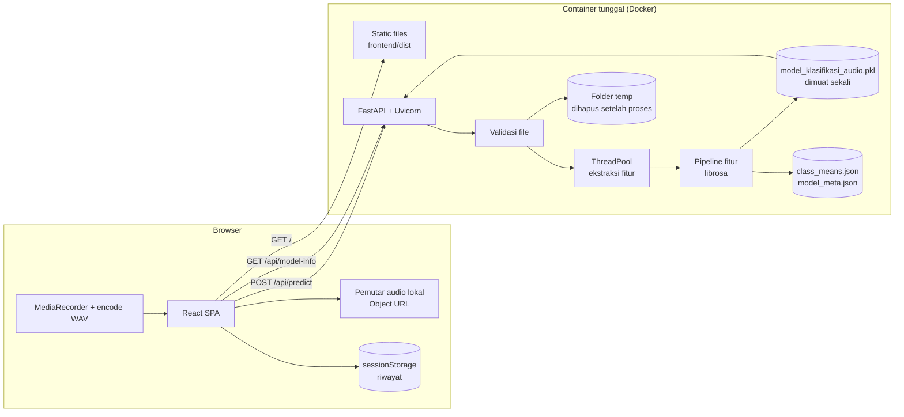
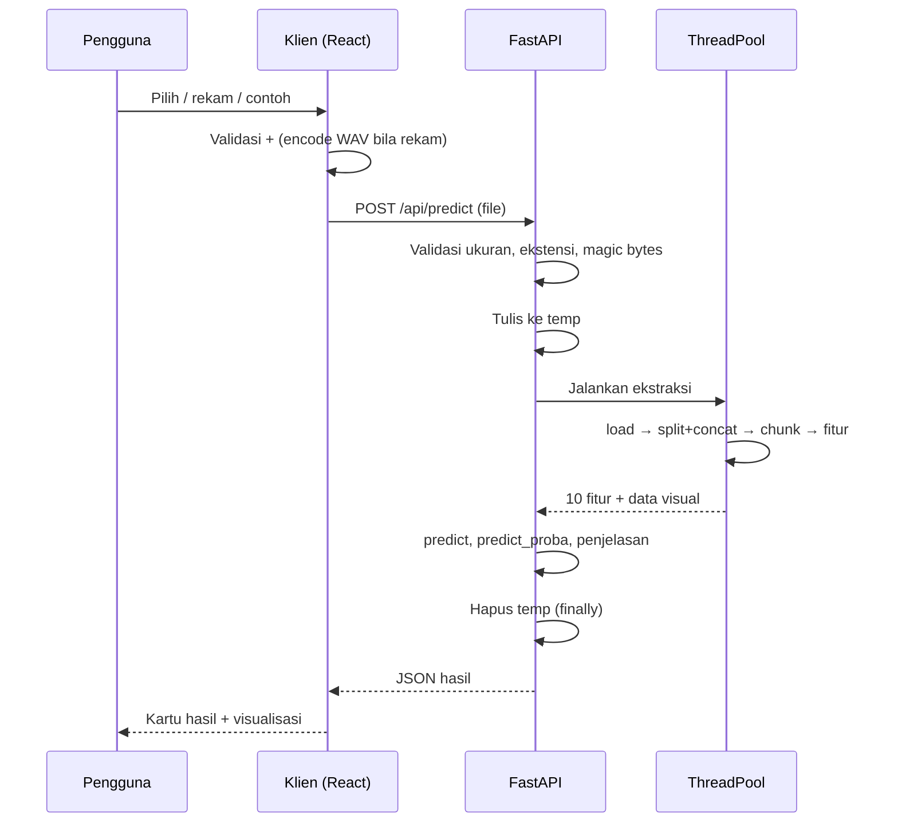

# Arsitektur — Sound Lab

**Ringkasan.** Sound Lab memakai satu container: backend Python (FastAPI) yang memuat model sekali saat startup dan juga menyajikan hasil build frontend (React + Vite). Pilihan ini menghindari CORS di produksi dan memudahkan deploy. Dokumen ini memuat diagram, stack dengan versi yang dipin, struktur folder, alur data, strategi model/threadpool/file temporer, konfigurasi, rencana deployment (dengan perbandingan hosting), dan trade-off.

## Daftar Isi
1. Keputusan Arsitektur
2. Diagram
3. Stack dan Versi
4. Struktur Folder
5. Alur Data End-to-End
6. Pemuatan Model
7. Konkurensi dan Threadpool
8. File Temporer dan Privasi
9. Validasi Input
10. CORS, Rate Limit, Logging
11. Konfigurasi `.env`
12. Deployment
13. Trade-off
14. Asumsi

---

## 1. Keputusan Arsitektur

| ID | Keputusan | Alasan |
|---|---|---|
| A1 | Backend Python + FastAPI | Model butuh librosa dan scikit-learn 1.8.0 |
| A2 | Frontend SPA: React 18 + TypeScript + Vite | Banyak komponen interaktif (pemutar, grafik, riwayat) |
| A3 | Produksi satu container: FastAPI menyajikan API (`/api/*`) dan file statis frontend | Satu layanan, tanpa CORS, deploy sederhana |
| A4 | Tanpa database | Riwayat disimpan di browser (sessionStorage); audio tidak disimpan |
| A5 | Grafik digambar kustom (SVG/Canvas), tanpa library chart besar | Kontrol penuh sesuai desain.md, bundle kecil |
| A6 | Rekaman mikrofon di-encode ke WAV mono di browser sebelum upload | Format WebM/MP4 dari MediaRecorder bervariasi antar browser dan tidak ada di daftar ekstensi PRD; WAV 30 dtk ≈ 2,6 MB (44,1 kHz mono 16-bit) |
| A7 | Audio sampel disajikan sebagai file statis dan dikirim lewat alur upload yang sama | Tidak perlu endpoint khusus |
| A8 | Waveform dan spektrogram dihitung di server dan dikirim ringkas dalam JSON | Konsisten dengan fitur model; klien tidak perlu DSP |

## 2. Diagram



## 3. Stack dan Versi

Versi dipin agar `.pkl` termuat tanpa peringatan. Set versi Python di bawah sudah diuji resolusi dependensinya dengan `pip install --dry-run` pada Python 3.12.3. Uji `pip install` penuh dan uji paritas fitur (model-spec.md §11) tetap wajib dijalankan di Tahap 0 dan 1.

| Komponen | Pilihan | Catatan |
|---|---|---|
| Python | 3.12 | scikit-learn 1.8.0 membutuhkan Python ≥ 3.11 |
| Model | `scikit-learn==1.8.0` | **Wajib persis**, sama dengan versi training |
| Audio | `librosa==0.11.0`, `soundfile==0.13.1`, `audioread==3.0.1`, `numba==0.61.2` | Dekode `.mp3` memakai ffmpeg/audioread |
| Numerik | `numpy==2.2.6`, `scipy==1.15.3`, `pandas==2.2.3`, `joblib==1.5.1` | `joblib` dipakai untuk memuat `.pkl` |
| Web | `fastapi==0.115.12`, `uvicorn[standard]==0.34.2`, `python-multipart==0.0.20`, `pydantic==2.11.4`, `pydantic-settings==2.9.1` | |
| Rate limit | `slowapi==0.1.9` | |
| Sistem | `ffmpeg`, `libsndfile1` | Dipasang di Dockerfile |
| Frontend | React 18, TypeScript 5, Vite 5, React Router 6, lucide-react | Versi dipin lewat `package-lock.json` |
| Font | Space Grotesk, Inter, JetBrains Mono | Google Fonts, fallback sistem |
| Tes | `pytest==8.3.5`, `httpx==0.28.1` | `requirements-dev.txt` |

**Isi `backend/requirements.txt`:**
```text
scikit-learn==1.8.0
numpy==2.2.6
scipy==1.15.3
pandas==2.2.3
joblib==1.5.1
librosa==0.11.0
numba==0.61.2
soundfile==0.13.1
audioread==3.0.1
fastapi==0.115.12
uvicorn[standard]==0.34.2
python-multipart==0.0.20
pydantic==2.11.4
pydantic-settings==2.9.1
slowapi==0.1.9
```

**Isi `backend/requirements-dev.txt`:**
```text
-r requirements.txt
pytest==8.3.5
httpx==0.28.1
```

**Spesifikasi Dockerfile** (konfigurasi, bukan kode aplikasi):
```dockerfile
# Tahap 1: build frontend
FROM node:20-slim AS fe
WORKDIR /app/frontend
COPY frontend/package*.json ./
RUN npm ci
COPY frontend/ ./
RUN npm run build

# Tahap 2: runtime
FROM python:3.12-slim
RUN apt-get update && apt-get install -y --no-install-recommends ffmpeg libsndfile1 \
    && rm -rf /var/lib/apt/lists/*
WORKDIR /app
COPY backend/requirements.txt ./backend/requirements.txt
RUN pip install --no-cache-dir -r backend/requirements.txt
COPY backend/ ./backend/
COPY data/ ./data/
COPY samples/ ./samples/
COPY --from=fe /app/frontend/dist ./frontend/dist
ENV PORT=8080
CMD ["sh", "-c", "uvicorn backend.app.main:app --host 0.0.0.0 --port ${PORT} --proxy-headers --forwarded-allow-ips='*'"]
```

## 4. Struktur Folder

```text
sound-lab/
├─ backend/
│  ├─ app/
│  │  ├─ main.py            # app FastAPI, lifespan, mount static
│  │  ├─ config.py          # pengaturan dari .env
│  │  ├─ api/               # router: predict, model_info, health
│  │  ├─ services/          # audio_loader, features, predictor, explain, visuals
│  │  ├─ schemas.py         # model Pydantic (sesuai api-spec.md)
│  │  └─ errors.py          # kode error + handler (pesan Indonesia)
│  ├─ tests/                # pytest: paritas fitur, validasi, integrasi API
│  ├─ requirements.txt
│  └─ requirements-dev.txt
├─ frontend/
│  ├─ src/
│  │  ├─ pages/             # Analisis, Riwayat, Bandingkan, TentangModel, BatasanEtika
│  │  ├─ components/        # tombol, kartu hasil, gauge, vu-meter, player, tabel, toast, modal
│  │  ├─ charts/            # waveform, spektrogram, mfcc, timeline, perbandingan fitur
│  │  ├─ lib/               # klien API, encode WAV, ekspor CSV, format angka
│  │  ├─ styles/            # token desain (CSS variables dari desain.md)
│  │  └─ main.tsx
│  ├─ package.json
│  └─ vite.config.ts        # proxy /api ke :8000 saat dev
├─ data/
│  ├─ model_klasifikasi_audio.pkl
│  ├─ class_means.json      # dibuat dari train_data.csv (model-spec.md §6)
│  ├─ model_meta.json       # metrik, confusion matrix, perbandingan model, importance
│  ├─ train_data.csv        # hanya untuk membuat class_means.json (tidak perlu di image produksi)
│  └─ fitur_audio.csv       # referensi uji paritas
├─ samples/                 # 3 audio contoh (berisik, non-berisik, ambigu) + samples.json
├─ docs/                    # PRD.md, desain.md, arsitektur.md, model-spec.md, api-spec.md, tasks-prompt.md
├─ Dockerfile
├─ .env.example
├─ .dockerignore
└─ README.md
```

Catatan: `model_klasifikasi_audio.pkl` boleh disimpan di Git bila ukurannya wajar (< 50 MB; Random Forest 100 pohon, kedalaman 10, umumnya jauh di bawah itu). Periksa ukuran sebelum commit.

## 5. Alur Data End-to-End

1. Pengguna memilih sumber audio (upload, rekam, atau contoh). Rekaman di-encode ke WAV mono di browser.
2. Klien memvalidasi ekstensi dan ukuran (≤ 15 MB).
3. Klien membuat Object URL untuk pemutar lokal, lalu mengirim `POST /api/predict` (multipart, field `file`).
4. Server memeriksa `Content-Length`, ekstensi, dan isi file (magic bytes) sambil menulis ke file temporer (dibatasi 15 MB).
5. Server menjalankan ekstraksi di threadpool: `librosa.load` → buang hening (split + concatenate) → chunk 3 detik → fitur per chunk → agregasi → 10 fitur sesuai urutan wajib.
6. Server memanggil `predict` dan `predict_proba` untuk agregat file, lalu prediksi per chunk, penjelasan, waveform, spektrogram, dan profil MFCC.
7. Server menghapus file temporer (blok `finally`) lalu mengirim JSON (skema di api-spec.md).
8. Klien merender hasil, menyimpan ringkasan ke riwayat (sessionStorage), dan mencabut Object URL saat entri dibuang.



## 6. Pemuatan Model
- Model dimuat **sekali** pada event `lifespan` startup memakai `joblib.load`.
- Validasi saat startup (gagal = aplikasi tidak siap, `/api/health` mengembalikan 503):
  - kunci dict lengkap: `model`, `selected_features`, `target_sr`, `top_db`, `chunk_duration`, `model_name`;
  - `selected_features` identik dengan urutan wajib 10 fitur;
  - `model.n_features_in_ == 10` dan `list(model.classes_) == ['berisik', 'non-berisik']`;
  - `target_sr == 22050`, `top_db == 25`, `chunk_duration == 3`.
- Jika `sklearn.__version__ != "1.8.0"`, hentikan startup dengan pesan jelas (bukan hanya peringatan).
- Muat juga `class_means.json` dan `model_meta.json`; validasi nama dan urutan fitur sama dengan `selected_features`.
- **Pemanasan:** setelah dimuat, jalankan ekstraksi pada sinyal sintetis 3 detik agar kompilasi numba/JIT dan impor lambat selesai sebelum permintaan pertama.
- Objek model dibagikan hanya-baca antar thread (`predict` pada Random Forest aman untuk dipakai bersamaan dengan `n_jobs=None`).

## 7. Konkurensi dan Threadpool
- Ekstraksi fitur adalah pekerjaan CPU. Endpoint dijalankan lewat `ThreadPoolExecutor(max_workers=MAX_WORKERS)` (default 2) agar event loop tidak terblokir.
- `asyncio.Semaphore(MAX_WORKERS)` membatasi proses bersamaan; permintaan tambahan menunggu paling lama `QUEUE_WAIT_S` (default 15 dtk), lalu mendapat 503 `SERVER_SIBUK`.
- Timeout proses per file: `PROCESS_TIMEOUT_S` (default 30 dtk) → 504 `PROSES_TIMEOUT`.
- Target performa: audio 30 dtk selesai < 10 dtk (p95) pada 2 vCPU. Angka ini wajib diukur di Tahap 1 dan Tahap 6; bila terlewati, kurangi resolusi spektrogram atau naikkan CPU.

## 8. File Temporer dan Privasi
- File ditulis ke `TMP_DIR` dengan nama acak (`uuid4`) dan ekstensi tervalidasi; nama asli pengguna tidak dipakai di disk.
- Penghapusan dijamin oleh blok `finally` (termasuk saat error dan timeout).
- Saat startup, semua file lama di `TMP_DIR` dihapus; tugas berkala menghapus file berumur > 10 menit sebagai jaring pengaman.
- Log tidak memuat isi audio maupun nama file asli; hanya ekstensi, ukuran, durasi, label, dan waktu proses.
- Respons membawa header `Cache-Control: no-store`.
- Tidak ada penyimpanan audio permanen dan tidak ada pengiriman audio ke layanan pihak ketiga.

## 9. Validasi Input
Urutan pemeriksaan (rincian kode error di api-spec.md):
1. Header `Content-Length` > 15 MB → 413 segera.
2. Field `file` tidak ada atau kosong → 400.
3. Ekstensi bukan `.mp3 .wav .ogg .flac .m4a` → 415.
4. Magic bytes tidak cocok dengan ekstensi → 415.
5. Ukuran terbaca > 15 MB saat streaming → 413 (hentikan dan hapus temp).
6. Dekode gagal (korup) → 422.
7. Durasi < 0,5 dtk atau > 120 dtk → 422.
8. Sinyal senyap total (puncak amplitudo < 1e-4) → 422.

## 10. CORS, Rate Limit, Logging
- **CORS:** produksi same-origin sehingga CORS tidak diaktifkan. Pengembangan: izinkan `http://localhost:5173` lewat `ALLOWED_ORIGINS`. Tidak memakai wildcard `*` di produksi.
- **Rate limit** (slowapi, per IP, mengikuti `X-Forwarded-For` di belakang proxy): `/api/predict` 10 per menit (`RATE_LIMIT_PREDICT`), endpoint lain 60 per menit (`RATE_LIMIT_DEFAULT`). Melebihi batas → 429 `TERLALU_BANYAK_PERMINTAAN` dengan header `Retry-After`.
- **Logging:** JSON per baris ke stdout; bidang: `ts`, `level`, `request_id`, `path`, `status`, `duration_ms`, `file_ext`, `file_size`, `audio_duration_s`, `label`, `confidence`. `request_id` dikembalikan juga di respons dan header `X-Request-ID`.

## 11. Konfigurasi `.env`

| Variabel | Default | Keterangan |
|---|---|---|
| `PORT` | `8080` | Port server |
| `MODEL_PATH` | `data/model_klasifikasi_audio.pkl` | Lokasi model |
| `CLASS_MEANS_PATH` | `data/class_means.json` | Rata-rata kelas |
| `MODEL_META_PATH` | `data/model_meta.json` | Metrik dan metadata |
| `SAMPLES_DIR` | `samples` | Folder audio contoh |
| `TMP_DIR` | `/tmp/soundlab` | Folder temporer |
| `MAX_FILE_MB` | `15` | Batas ukuran |
| `MAX_DURATION_S` | `120` | Durasi maksimum |
| `MIN_DURATION_S` | `0.5` | Durasi minimum |
| `CONFIDENCE_WARN_THRESHOLD` | `0.65` | Ambang peringatan |
| `MAX_WORKERS` | `2` | Pekerja ekstraksi |
| `QUEUE_WAIT_S` | `15` | Batas tunggu antrean |
| `PROCESS_TIMEOUT_S` | `30` | Batas waktu proses |
| `RATE_LIMIT_PREDICT` | `10/minute` | Batas `/api/predict` |
| `RATE_LIMIT_DEFAULT` | `60/minute` | Batas endpoint lain |
| `ALLOWED_ORIGINS` | *(kosong)* | Daftar origin dev, pisah koma |
| `LOG_LEVEL` | `INFO` | Level log |

## 12. Deployment

### 12.1 Pengembangan
- Backend: virtualenv Python 3.12, `pip install -r backend/requirements-dev.txt`, jalankan Uvicorn dengan reload di port 8000.
- Frontend: `npm run dev` (port 5173) dengan proxy `/api` ke `localhost:8000`.
- ffmpeg harus terpasang di mesin lokal untuk menguji `.mp3` dan `.m4a`.
- Cadangan demo: jalankan lokal dan buka lewat jaringan yang sama atau terowongan sementara bila hosting bermasalah.

### 12.2 Perbandingan opsi hosting (diperiksa Oktober 2026; verifikasi ulang sebelum deploy karena kebijakan sering berubah)

| Opsi | Sumber daya | Biaya | Cold start dan idle | Risiko untuk proyek ini |
|---|---|---|---|---|
| **Google Cloud Run** (container, scale to zero) | Bisa diatur, mis. 2 vCPU dan 2 GiB | Kuota gratis bulanan (180.000 vCPU-detik, 360.000 GiB-detik, 2 juta request; berbasis permintaan) | Mati saat idle; instance pertama perlu memuat model (perkiraan 5–20 dtk, **ukur**) | Wajib mengaktifkan akun penagihan (kartu). Lewat kuota = ditagih |
| **Render** (Web Service Docker) | Free: 512 MB RAM dan 0,1 CPU; Starter $7/bln: 512 MB dan 0,5 CPU; Standard $25/bln: 2 GB dan 1 CPU | Free $0 | Free mati setelah 15 menit idle dan butuh sekitar 1 menit untuk bangun | Free: RAM 512 MB dan 0,1 CPU **tidak realistis** (RAM tipis, target 10 dtk hampir pasti gagal) |
| **Hugging Face Spaces** (Docker) | CPU Basic: 2 vCPU dan 16 GB RAM | CPU Basic tanpa biaya per jam, tetapi membuat Space Docker memerlukan paket berbayar (PRO) | Tidur setelah tidak dipakai dan bangun saat diakses | Butuh langganan; Space statis (hanya frontend) gratis, tetapi backend Python tidak bisa jalan di sana |

**Rekomendasi: Google Cloud Run**, dengan konfigurasi 2 vCPU, 2 GiB, `concurrency=4`, `timeout=60s`, `max-instances=2`, region terdekat (mis. `asia-southeast2` atau `asia-southeast1`). Alasan: satu-satunya opsi gratis yang memberi RAM dan CPU cukup untuk librosa + scikit-learn serta menjalankan Dockerfile apa adanya.

**Cold start dan RAM**
- Perkiraan RAM: proses dasar (Python + numpy + librosa + numba + scikit-learn + model) sekitar 300–500 MB; audio 120 dtk pada 22.050 Hz hanya ± 10 MB sinyal tetapi spektrogram dan fitur menambah puncak sementara. Karena itu 512 MB tidak disarankan dan 1 GiB adalah batas bawah; ukur dengan audio 120 dtk di Tahap 6.
- Cold start diatasi dengan: pemanasan model saat startup, spinner dengan teks "Server sedang bangun, mohon tunggu" bila respons pertama > 5 dtk, dan timeout klien 60 dtk.
- **Hari presentasi:** set `min-instances=1` satu hari sebelumnya (berbiaya selama aktif), buka aplikasi 10 menit sebelum sesi, lalu kembalikan ke 0 sesudahnya.
- Pasang anggaran dan alert tagihan di Google Cloud sebelum deploy.

**Bila tidak ada kartu/penagihan:** pakai cadangan lokal (12.1), atau Render Standard berbayar untuk hari presentasi saja. Opsi Render Free hanya dapat dipakai untuk uji coba kecil, bukan untuk demo.

### 12.3 Alur produksi
1. `docker build` lokal, jalankan, uji `GET /api/health` dan satu `POST /api/predict`.
2. Dorong image ke registry, deploy ke layanan terpilih dengan variabel `.env`.
3. Uji pasca-deploy: health, model-info, predict dengan 3 contoh bawaan, ukur waktu proses audio 30 dtk dan 120 dtk.

## 13. Trade-off

| Pilihan | Dipilih | Alternatif | Alasan |
|---|---|---|---|
| Deploy | Satu container | Frontend (CDN) + backend terpisah | Lebih sederhana, tanpa CORS; biaya dan kompleksitas lebih rendah |
| Riwayat | sessionStorage | Database | Memenuhi privasi dan tanpa penyimpanan permanen |
| Visual | Dihitung di server | Dihitung di klien | Konsistensi dengan fitur model dan sesuai spesifikasi; ukuran JSON lebih besar (± 100 KB) |
| Rekaman | WAV dari klien | WebM dikonversi server | Sederhana dan format konsisten, ukuran upload lebih besar |
| Konkurensi | ThreadPool 2 pekerja | Antrean tugas (Celery/Redis) | Tanpa infrastruktur tambahan; cukup untuk demo |
| Model | Dimuat saat startup | Dimuat per permintaan | Latensi jauh lebih rendah |
| Penjelasan | Heuristik jarak ke rata-rata kelas | SHAP | Ringan dan dapat dijelaskan; SHAP menambah dependensi dan waktu |

## 14. Asumsi
1. Ukuran `.pkl` kecil (< 50 MB) dan boleh disimpan di repositori.
2. `train_data.csv` dan `fitur_audio.csv` tersedia untuk membuat `class_means.json` dan uji paritas.
3. Pengguna memiliki akun hosting yang sesuai; bila tidak, demo berjalan lokal.
4. Trafik rendah (demo kelas): ≤ 10 permintaan per menit.
5. Versi library diverifikasi lewat `pip install` penuh di Tahap 0; bila ada konflik, ubah versi pendukung (bukan `scikit-learn`) dan catat di README.
